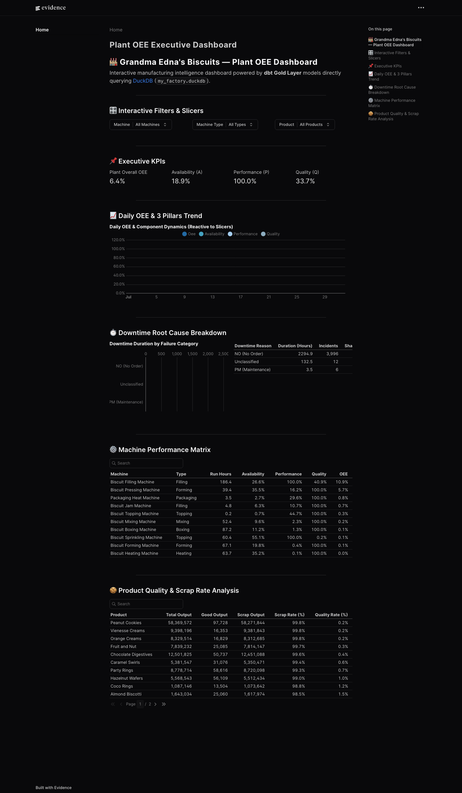

# OEE Manufacturing Analysis

An end-to-end manufacturing intelligence project designed to analyze and optimize **Overall Equipment Effectiveness (OEE)** for a biscuit manufacturing plant (Grandma Edna's Biscuits). Built using the **Medallion Architecture (Bronze - Silver - Gold)** combined with a **Star Schema** data warehouse powered by **DuckDB**, **dbt**, and **Evidence.dev**.

---

## 🎯 Project Objectives

- **OEE Measurement**: Accurately calculate the 3 foundational pillars — **Availability (A)**, **Performance (P)**, **Quality (Q)** — and plant-wide OEE across individual machines, product categories, and shifts.
- **Root Cause Analysis (RCA)**: Pinpoint unplanned downtime drivers, speed losses, and severe scrap generation rates.
- **Decision Support**: Deliver 10 dedicated analytical SQL models solving core operational challenges, paired with an interactive BI dashboard.

---

## 🛠 Tech Stack

- **Storage / Warehouse**: [DuckDB](https://duckdb.org/) (High-performance, embedded in-process OLAP database)
- **Transformation**: [dbt-core](https://www.getdbt.com/) & `dbt-duckdb`
- **BI & Visualization**: [Evidence.dev](https://evidence.dev/) (Code-first BI: Markdown + SQL + Svelte charts)
- **Data Ingestion & Scripts**: Python (`pandas`, `openpyxl`, `duckdb`)
- **Documentation & Reporting**: SQL, Excel, Automated Dashboard PDF reports

---

## 🏗 Data Pipeline Architecture

```
[ Raw Excel Data Source ] 
           │
           ▼ (split_and_load.py)
[ Bronze Layer ]   ──> bronze.fact, bronze.machine, bronze.product, bronze.target_speeds
           │
           ▼ (dbt staging - silver views)
[ Silver Layer ]   ──> stg_fact, stg_machine, stg_product, stg_target_speeds
           │
           ▼ (dbt marts - gold tables)
[ Gold Layer ]     ──> Star Schema:
                       • Dimensions: dim_machine, dim_product, dim_date
                       • Facts: fct_daily_oee, fct_production_runs
           │
           ▼
[ Evidence Dashboard ] ──> Interactive Slicers, KPIs & Trend Visualizations
```

---

## 📁 Project Directory Structure

```text
├── dashboard/            # Interactive web dashboard (Evidence.dev)
│   ├── pages/            # Dashboard markdown pages with reactive SQL
│   └── sources/          # DuckDB datasource connections & queries
├── docs/                 # Architecture guides, data lineage, and dashboard specs
│   └── images/           # High-resolution dashboard screenshots
├── excel/                # Sample datasets and analytical Excel reports
├── models/
│   ├── staging/          # Silver layer: data cleansing, deduplication, typing
│   └── marts/            # Gold layer: Fact & Dimension tables (Star Schema)
├── query/                # 10 deep-dive SQL queries answering strategic questions (Q1 - Q10)
├── check_data.py         # Diagnostic script for DuckDB tables
├── dbt_project.yml       # dbt project configuration
├── profiles.yml          # dbt connection profiles for DuckDB
├── requirements.txt      # Python dependencies
├── run_query.py          # Fast SQL execution helper
└── split_and_load.py     # Excel ingestion script to Bronze layer
```

---

## 📊 Interactive BI Dashboard (Evidence.dev)

A fully automated, reactive manufacturing analytics dashboard querying the **Gold Layer** in real time:

- **Interactive Slicers**: Multi-dimensional filtering by **Machine**, **Machine Type**, and **Product**.
- **Real-Time Calculation**: All KPI cards, daily component trends, downtime Pareto bars, and scrap tables dynamically recalculate based on the active slicer selection.

<p align="center">
  
</p>

---

## 🚀 Getting Started

### 1. Environment Setup

```bash
# Create and activate Python virtual environment
python3 -m venv .venv
source .venv/bin/activate

# Install required Python packages
pip install -r requirements.txt
```

### 2. Ingest Source Data into DuckDB (Bronze)

```bash
python split_and_load.py
```

### 3. Build Data Models with dbt (Silver & Gold)

```bash
# Verify dbt connection to DuckDB
dbt debug

# Build all models (staging views & mart tables)
dbt run

# Run data integrity tests
dbt test
```

### 4. Execute Business Intelligence Queries

Run the analytical SQL scripts in the `query/` folder directly on DuckDB or use the query runner script:

```bash
python run_query.py
```

### 5. Launch the Web Dashboard (Evidence.dev)

```bash
cd dashboard

# Extract and sync data from DuckDB Gold Marts
npm run sources

# Start the local development server
npm run dev
```

Open your browser at **`http://localhost:3000`** to interact with the dashboard.

---

## 📈 Strategic Business Questions Answered (`query/`)

- **Q1 - Q3 (Macro Health & Stability)**: Overall plant OEE baseline, machine performance rankings, and daily volatility trends.
- **Q4 - Q6 (Downtime & Losses)**: Unplanned downtime root causes, shift-level variance, and machine speed degradation (Speed Loss).
- **Q7 - Q8 (Quality & Scrap)**: Product defect rates, scrap distribution, and machine-product compatibility matrix.
- **Q9 - Q10 (Capacity & Optimization)**: Actual output vs. engineering design limits, accompanied by high-ROI bottleneck remediation roadmaps.

---

## 📄 License & Information

This project is developed for educational and industrial research purposes in manufacturing data engineering and operational excellence.
